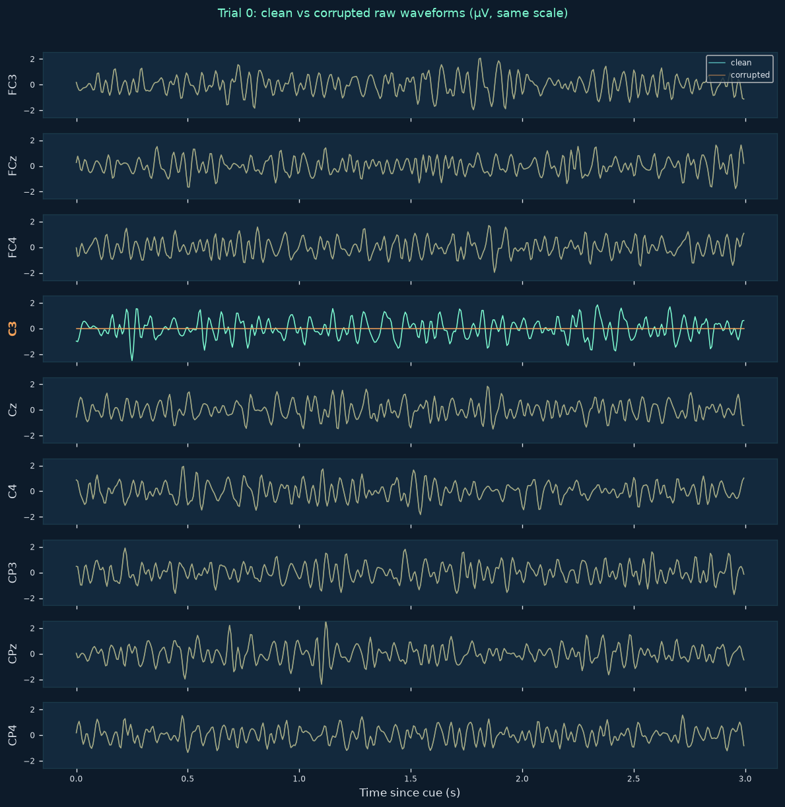

# EEG Channel Failure Lab

Measure how simulated EEG channel failures affect a trained classifier.

This project trains a subject-specific CSP + LDA motor-imagery classifier on
public PhysioNet EEG, then replays its held-out evaluation with controlled
channel failures (flatline, additive noise, gain error, channel swap) and
reports exactly how predictions change — with honest accounting of prediction
failures, coverage, and paired trial-level transitions.

An interactive Streamlit app lets you explore failures channel by channel and
severity by severity; a fully offline synthetic demo works without any
downloads or credentials.

> **Synthetic demonstration — not evidence of performance on human EEG.**
> Metrics from synthetic mode are kept strictly separate from real-data
> results and are labeled as such everywhere in the app and reports.

---

## Problem and scope

Real BCI systems suffer channel failures: electrodes detach, amplifiers
saturate, connectors mislabel channels. This project answers a narrow,
measurable question: *when a specific channel fails in a specific way, how
does a trained decoder's held-out performance change?*

Scope of this release:

- One dataset: [PhysioNet EEGMMIDB v1.0.0](https://physionet.org/content/eegmmidb/1.0.0/)
  (Schalk 2009; ODC-By 1.0 license — raw recordings are **not** redistributed).
- One task: motor **imagery**, left vs. right fist. Runs **4 + 8** train,
  run **12** evaluates (held out). Hands/feet runs (6/10/14) are rejected by
  the loader and never mixed in. T1 → left, T2 → right; T0 rest excluded.
  Mapping was verified against the PhysioNet documentation before implementation.
- Subjects 1–5, subject-specific models.
- One montage: `FC3, FCz, FC4, C3, Cz, C4, CP3, CPz, CP4` (exact order).
- One baseline: MNE CSP (4 components, ledoit_wolf, log) + sklearn LDA
  (lsqr, shrinkage auto), fitted on training runs only.

## Installation and quick start

Tested with Python 3.13.14 on Windows (PowerShell); any Python ≥3.11 with
current package versions should work.

```powershell
git clone https://github.com/Munt33q/eeg-channel-failure-lab.git
cd eeg-channel-failure-lab
python -m venv .venv
.\.venv\Scripts\python.exe -m pip install -e ".[dev]"
.\.venv\Scripts\python.exe -m streamlit run app.py
```

The app opens in **Synthetic** mode: fully offline, no credentials, prominently
labeled as a demonstration. Switch to **Real data** mode after running the
pipeline below.

The repository includes small project-produced numeric model artifacts and
summary result files. Raw EDF recordings are never included; Real-data mode
requires the PhysioNet download step below.

## Failure definitions

| Failure | What happens | Notes |
|---|---|---|
| Flat channel | Selected channel replaced with constant 0 µV over the whole run | Zero-fill is a *simulated flatline*, not physical channel removal |
| Additive noise | Seeded Gaussian noise with explicit SD in µV added to the selected channel | Severity grid: 0, 5, 10, 20, 50 µV; seeds 7, 19, 42 (repeated seeds measure corruption variability, not extra subjects) |
| Gain error | Selected channel multiplied by a factor | Grid: 0, 0.25, 0.5, 1, 2, 4 (attenuation and amplification; 1 is an identity) |
| Channel swap | The signals of two channel names are exchanged | Simulates a *channel-assignment error*; applying it twice restores the input |

Corruptions are applied to **raw** selected-channel data **before** common-average
referencing, causal filtering, and epoching. Clean and corrupted copies then
flow through the identical preprocessing pipeline independently. Note that
common-average referencing spreads one channel's corruption into the other
channels — the app shows both raw and processed views so this is visible.

## Preprocessing and split details

| Parameter | Value |
|---|---|
| Channels (exact order) | FC3, FCz, FC4, C3, Cz, C4, CP3, CPz, CP4 |
| Referencing | Common average across those nine channels, per sample |
| Filter | Butterworth bandpass 8–30 Hz, 4th order, SOS, applied with `scipy.signal.sosfilt` (forward-only, causal; never `filtfilt`); state resets per run |
| Epochs | [1.0, 3.0) s after cue onset → 320 samples at 160 Hz |
| Baseline correction | none |
| Units | volts internally; µV for corruption severities and all displays |
| Sampling rate | 160 Hz (verified per recording at load time) |
| CSP | 4 components, `reg="ledoit_wolf"`, `log=True`, `norm_trace=False` |
| LDA | `solver="lsqr"`, `shrinkage="auto"` |
| Seed | 42 for any randomized operation |
| Train / eval split | runs 4+8 / run 12, subject-specific; no overlap |

Trial eligibility is **frozen from clean-data checks only** (nonfinite, flat,
out-of-bounds, filter settling). Corrupted trials keep their clean eligibility
and are never dropped silently. If corruption makes a model input invalid or a
prediction fails, it is counted and treated as **incorrect** in the primary
accuracy, with coverage reported alongside. Accuracy among successfully
predicted trials is shown separately and clearly labeled.



*Real data (subject 1, held-out run 12, trial 0): a simulated flatline on C3
(amber) compared with the clean signal (teal). All nine channels shown on the
same µV scale; the affected channel label is highlighted.*

## Measured results

Measured on this machine (Python 3.13.14, package versions in
`results/config_*.json`); reproduce with the commands below. 15 eligible
trials per subject on held-out run 12; models trained on 30 trials (runs 4+8).
No corrupted trial was dropped; prediction failures were 0 in all sweeps
(coverage 100%).

### Clean baseline (subject-specific, held-out run 12)

| Subject | Clean accuracy | Balanced acc. | Majority baseline (train labels) | Eligible trials |
|--------:|---------------:|--------------:|---------------------------------:|----------------:|
| 1 | 0.800 | 0.804 | 0.533 | 15 |
| 2 | 0.733 | 0.723 | 0.500 | 15 |
| 3 | 0.533 | 0.545 | 0.500 | 15 |
| 4 | 0.667 | 0.688 | 0.500 | 15 |
| 5 | 0.600 | 0.598 | 0.533 | 15 |
| **Unweighted mean** | **0.667** | | | |

Subjects 3 (0.533) sits at its majority baseline (0.500) — the decoder
essentially fails for that subject on run 12, and the report shows it rather
than hiding it.

### Channel failure sensitivity (unweighted subject mean accuracy drop, pp)

Positive values = corrupted accuracy lower than clean accuracy.

| Failure | C3 | Cz | C4 | FC3 | FCz | FC4 | CP3 | CPz | CP4 |
|---|---:|---:|---:|---:|---:|---:|---:|---:|---:|
| Flat (0 µV) | +14.7 | +5.3 | +13.3 | +12.0 | +13.3 | +14.7 | +13.3 | +12.0 | +17.3 |
| Noise 50 µV | +14.7 | +10.7 | +17.3 | +14.7 | +14.7 | +17.3 | +17.3 | +13.3 | +17.3 |
| Gain 0 (dead) | +14.7 | +5.3 | +13.3 | +12.0 | +13.3 | +14.7 | +13.3 | +12.0 | +17.3 |

### Noise severity curve (subject mean drop, pp; channels C3 / Cz / C4)

| Noise SD | C3 | Cz | C4 |
|---:|---:|---:|---:|
| 5 µV | +6.7 | +2.7 | +4.0 |
| 10 µV | +14.7 | +5.3 | +9.3 |
| 20 µV | +14.7 | +2.7 | +13.3 |
| 50 µV | +14.7 | +10.7 | +17.3 |

### Example single-failure experiment (subject 1, flat C3)

- Clean accuracy 0.800 → corrupted 0.467 (**−33.3 pp**)
- Prediction flip rate 0.467; correct→incorrect 6, incorrect→correct 1
- Clean confusion (tn/fp/fn/tp): 6/1/2/6 → corrupted: 7/0/8/0 (the corrupted
  decoder predicts "left" for every trial)
- Coverage 1.0; 0 prediction failures

### Honest reading of these numbers

- Degradation is *measured, not guaranteed*: with 15 trials per subject,
  some individual (subject, channel, severity) combinations show drops of 0
  or slightly negative (improvement) even though subject means are positive.
- Flat and gain-0 produce identical drops for a channel (both zero the raw
  signal); they are separate failure types because they diverge for non-zero
  constants or partial-window intervals.
- Midline Cz is the *least* damaging single-channel failure in this setup —
  consistent with common-average referencing diluting one channel's failure
  plus Cz carrying less class-discriminative amplitude in this task. This is
  a statement about **this pipeline's sensitivity**, not about Cz's
  physiological role.
- Corrupted predictions collapse toward one class for flat C3 in subject 1
  (see confusion matrices above): the failure does not merely add noise, it
  can bias the CSP features systematically.

## Reproduction commands

```powershell
# 1. Download PhysioNet EEGMMIDB (subjects 1-5, runs 4/8/12; ~37 MB)
.\.venv\Scripts\python.exe scripts\prepare_data.py --subjects 1 2 3 4 5

# 2. Train subject-specific CSP+LDA on runs 4+8 only
.\.venv\Scripts\python.exe scripts\train.py --subjects 1 2 3 4 5

# 3. Example paired failure experiments (writes results/)
.\.venv\Scripts\python.exe scripts\evaluate_failures.py --subject 1 --failure flat --channel C3
.\.venv\Scripts\python.exe scripts\evaluate_failures.py --subject 1 --failure noise --channel Cz --severity 20 --seeds 7 19 42
.\.venv\Scripts\python.exe scripts\evaluate_failures.py --subject 1 --failure swap --channels C3 C4

# 4. Full channel x severity sweep, all subjects
.\.venv\Scripts\python.exe scripts\evaluate_failures.py --all-subjects --sweep

# 5. Tests (synthetic) and real-data integration checks
.\.venv\Scripts\python.exe -m pytest -q
.\.venv\Scripts\python.exe -m pytest -q -m integration

# 6. The app
.\.venv\Scripts\python.exe -m streamlit run app.py
```

Every experiment writes a config JSON next to its metrics, recording the
failure spec, seeds, channel order, subjects, and package versions.

## Exported reports

The app's Export tab produces:

- Per-trial predictions CSV (clean and corrupted predictions side by side)
- Aggregate metrics CSV
- Experiment configuration JSON
- Standalone HTML report with embedded plots, no external resources, and all
  input-derived text HTML-escaped

Reports include units, montage, preprocessing order, failure placement,
seeds, model identity, data identifiers, and the evaluation split.

## Limitations and honest-interpretation notes

- **Model sensitivity ≠ physiology.** A prediction change under simulated
  channel failure measures *model sensitivity to that failure*, not the
  physiological importance of a channel.
- **LDA probabilities are not calibrated confidence.** They are decision
  values; they are never presented as calibrated confidence.
- **Tiny evaluation sets.** 15–30 trials per subject; single-run held-out
  evaluation; subject-specific models. Nothing here measures cross-subject
  generalization.
- **Simulated failures.** Real hardware failures have dynamics (drift,
  intermittence, impedance changes) that constant zero-fill, stationary
  Gaussian noise, fixed gains, and clean swaps do not capture.
- **Common-average referencing spreads corruption** into all nine channels;
  this is a property of the chosen reference, shown deliberately in the app.
- **Synthetic mode is a demonstration** of mechanics, not evidence about
  human EEG or classifier performance on human data.
- Repeated noise seeds quantify **corruption variability**, not additional
  independent subjects.
- The baseline was frozen before looking at run-12 corrupted outcomes; no
  parameter was tuned against evaluation results.

## License and attribution

- Code: MIT (see `LICENSE`).
- Data: [PhysioNet EEGMMIDB](https://physionet.org/content/eegmmidb/1.0.0/)
  is licensed [ODC-By 1.0](https://physionet.org/content/eegmmidb/view-license/1.0.0/).
  Raw recordings are downloaded at runtime and never committed. If you
  publicly convey a database or produced work containing the data, include:
  *"Contains information from the EEG Motor Movement/Imagery Dataset which is
  made available under the ODC Attribution License."*
- Please cite: Schalk, G., McFarland, D.J., Hinterberger, T., Birbaumer,
  N., Wolpaw, J.R. BCI2000: A General-Purpose Brain-Computer Interface (BCI)
  System. IEEE TBME 51(6):1034-1043, 2004.

## References

- Schalk et al. 2004 (BCI2000, dataset) — above.
- Goldberger et al. 2000, *Circulation* — PhysioBank/PhysioNet.
- Blankertz et al. 2008 — common spatial patterns for motor imagery BCI.
- MNE-Python: Gramfort et al. 2013.
